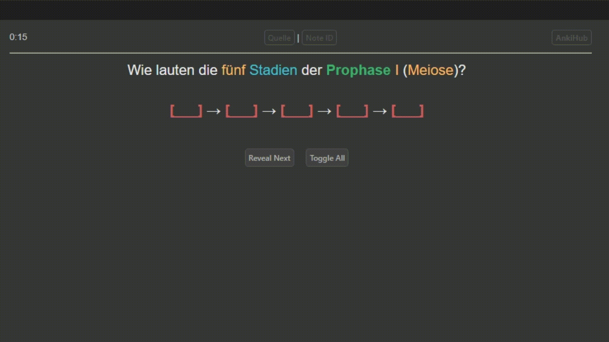

## Notiztypen für das [Ankizin Klinik-Deck](https://www.ankizin.de/)!
Aktuellste Version stets auf [AnkiCollab](https://www.ankizin.de/wiki/ankicollab-grundlagen-und-installation-von-ankizin/)!

## PFLICHT für das Ankizin-Deck! (YouTube-Video)

# Ankizin Notetypes AddOn
<b>Dieses AddOn basiert auf dem [AnKing Notes AddOn](https://github.com/AnKing-VIP/anking_notes_addon). Schaut gerne dort auch vorbei.</b> 
This add-on is based on the [AnKing Notes AddOn](https://github.com/AnKing-VIP/anking_notes_addon). Please consider checking out their work.

## One-by-one Clozes

## <a href="https://www.ankizin.de/wiki/" rel="nofollow">WIKI / FAQ / Quick-Fixes</a>
<b>Viele Probleme lassen sich direkt durch einen globalen Notiztyp-Reset beheben ("`Alle zurücksetzen`").</b> AddOn-Kreuzkompatibilitäten sind nicht garantiert!

## sonstige Probleme, Bugs, Fehler, Verbesserungen
Bitte <a href="https://github.com/ProjektAnki/notetype-addon/issues" rel="nofollow">hier</a> melden.
- Heuristisches Einrücken ist inkompatibel mit [Edit Field During Review (Cloze) [ID: 385888438]](https://ankiweb.net/shared/info/385888438)
- AddOns, die den Karten-Screen scrollen wollen (e.g. Contanki, _scroll with vim-like keys_, etc.) benötigen eine kleine Styling-Änderung unter _ADVANCED_ → _Custom Styles_: `#qa #container { overflow-y: unset !important; }` 

**Aktiver Support stets nur für die aktuelle Version von Anki (aktuell: 24.04.1)!**

## Updates
- 2026-10-21: LERNPLAN-MANAGER-UPDATE — eigene Reihenfolge für die Lerntage
  - Lerntage per Drag & Drop umsortieren und als gelernt abhaken; der automatische Tageswechsel folgt deiner Reihenfolge
  - `!VORHERIGE LERNTAGE` und `!FÄLLIGE KARTEN VERGANGENER LERNTAGE` enthalten alle gelernten Tage, egal in welcher Reihenfolge
  - Zuverlässigere Stapel-Erstellung (ein Rückgängig-Schritt, keine leeren Reststapel)
- <strong>2026-05-24: UMZUG des Ankizin-Decks zu [AnkiCollab](https://www.ankicollab.com/notes/decke-schaufeln-reiche)</strong>
- 2025-06-24: LERNPLAN-MANAGER-UPDATE — mehr und spezifischere Optionen für Ankizin V5
- 2025-05-01: LERNPLAN-MANAGER-UPDATE — Pünktlich zum Tag der Arbeit wird die Anki-Arbeit noch weniger
- 2025-03-02: LERNPLAN-MANAGER — Der Lernplan-Manager nimmt dir die essentiellsten Aufgaben der täglichen Deck-Erstellung im Lernplan ab!
- 2024-12-24: WEIHNACHTS-Update — 3 neue Notiztypen (`Vocab`, `AnatomieTrainer` und `IO`), Einstellungen für Vorder- und Rückseite nun konsolidiert, kleine Styling-Fixes und Indent-Optimierungen
  - INFO: `IO` basiert auf dem nativen Anki-IO-Notiztyp, eingeführt in Version 23.10 — frühere Anki-Versionen werden **nicht** mehr supported und mit Updates versorgt, AddOn bleibt aber verfügbar!
- 2024-09-30: Kleine Styling-Fixes, PopUp-Fenster für neue Deck-Versionen
- 2024-06-26: Fix von AnkiWeb
- 2024-05-25: Fix von `Selective One By One`-Verhalten
- 2024-05-21: Custom-Script-Insertion hinzugefügt
- 2024-04-07: MEDITRICKS-AddOn-Support + Fix der meisten Tabellen
- 2024-03-06: Fix für die in AnkiDroid v2.17 eingeführten App-spezifischen Styling-Änderungen
- 2024-02-03: Fix der Updating-Routine (`Alle zurücksetzen` setzt nun wirklich alle zurück)
- 2024-01-23: HistoTrainer-Notetype hinzugefügt
- 2024-01-04: NEW-YEARS-Update — Update zu AnKing v2.9.4 (Anzeige Notiztypen-Einstellungen auch ohne Basis-Notiztypen; Live-Editing auch für Notiztyp-Derivate) + kleine Styling und Einrücken-Verbesserungen
- 2023-12-27: Fix von 1by1 auf AnkiDroid (→ AnkiDroid-spezifische HTML-ID-Dopplung identifiziert und gehackte Workarounds entfernt)
- 2023-12-22: XMAS-Update — Fix von Clozes, die nicht richtig auf Taps reagieren, fehlenden Cloze-Hints auf iOS und nicht-un-blur-baren Bildern
- 2023-12-10: Fix von Linux-Crashes, Fix von dunklen Balken im Notiztyp auf Windows
- 2023-12-08: Fix von falschen Cloze-Hints auf iOS
- 2023-12-07: Fix von fehlenden Cloze-Hints, fehlendem Countdown-Timer (der war nur transparent :D), Verbesserung von Bild-Filtern
- 2023-12-06: Nikolaus-Update — Fix von nicht funktionierenden Karten auf AnkiDroid, sowie fehlenden Buttons auf der Blickdiagnose-Rückseite + große Veränderungen des 1by1-Handlings under the hood

## Schaut gerne hier vorbei:
- <a href="https://ankizin.de" rel="nofollow">Ankizin Projekt-Webseite</a> — <i>Weitere Infos zu Ankizin und wie Ihr mitwirken könnt!</i>
- <a href="https://discord.com/invite/5DMsDg8Rvu" rel="nofollow">Discord-Server</a> — <i>Tipps, Tricks und weitere Hilfestellungen</i>
- <a href="https://www.instagram.com/ankizin_bvmd/" rel="nofollow">Instagram</a>: <i>@ankizin_bvmd</i>
- <a href="https://linktr.ee/anki_germany" rel="nofollow">Linktree mit weiteren Links</a>
